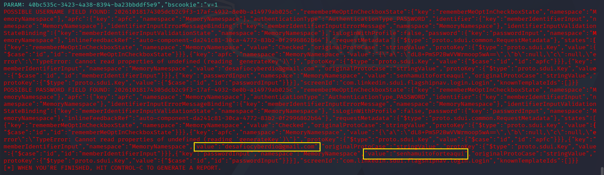

## Antes de mais nada, algumas resalvas:
### - O curso está desatualizado, algumas ferramentas, métodos e modelos ensinados estão obsoletos.
### - Para concluir o desafio pede a clonagem do Facebook, mas hoje em dia o mesmo não é possível clonar pelo setoolkit.
### - Por conta dos imprevistos, escolhi outro site para clonar, a página de login do linkedin(apenas para fins de estudo).

# Phishing para captura de senhas do Linkedin

### Ferramentas

- Kali Linux
- setoolkit

### Configurando o Phishing no Kali Linux

- Acesso root: ``` sudo su ```
- Iniciando o setoolkit: ``` setoolkit ```
- Tipo de ataque: ``` Social-Engineering Attacks ```
- Vetor de ataque: ``` Web Site Attack Vectors ```
- Método de ataque: ```Credential Harvester Attack Method ```
- Método de ataque: ``` Site Cloner ```
- Obtendo o endereço da máquina: ``` ifconfig ```
- URL para clone: http://www.linkedin.com/login

### Resutados

